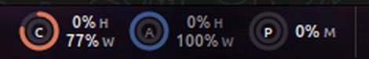

# CotaBar

[English](README.md) · [Português](README.pt-BR.md) · **Español**

**Sabe cuánto llevas gastado de los límites de tus IAs de código — sin salir del escritorio.**
CotaBar es un applet para el panel de Linux Mint / **Cinnamon** que muestra el uso de
**Claude Code**, **Codex (ChatGPT)**, **Antigravity (Gemini)** y **GitHub Copilot**:
la ventana corta (5 horas / día) y la larga (semana / mes), una al lado de la otra.



[](https://github.com/Davicjc/cotabar/actions/workflows/testes.yml)


Se acabó el "has alcanzado tu límite" en mitad de una tarea. Con un vistazo al panel sabes
si seguir, cambiar de herramienta o esperar al reinicio.

## Qué se ve

Cada IA es un anillo doble con su letra en el centro:

- **anillo exterior** — ventana larga (semana o mes)
- **anillo interior** — ventana corta (5 horas o día)
- al lado, los dos porcentajes con la letra del período: **H** horas, **D** día,
  **S** semana, **M** mes (p. ej. `84% H` / `61% S`). Se ponen ámbar desde el 80% y rojos desde el 95%.

Al hacer clic se abre cada límite con una barra, el porcentaje y cuándo se reinicia
("se reinicia en 4 h 47 min · 13:10").

La interfaz está en **español, inglés y portugués** (automático, o elígelo en la configuración).

## Herramientas compatibles

| IA | Letra | De dónde lee | Ventanas |
|---|---|---|---|
| **Claude Code** | C | `~/.claude/.credentials.json` → `api.anthropic.com/api/oauth/usage` (lo mismo que `/usage`) | sesión de 5 h, semana, semana por modelo, uso extra del mes |
| **Antigravity** (`agy`) | A | `~/.gemini/antigravity-cli/antigravity-oauth-token` → `retrieveUserQuotaSummary` de Cloud Code | 5 h y semana por grupo de modelos (Gemini, Claude/GPT, Argon) |
| **Codex** (ChatGPT) | X | `~/.codex/auth.json` → `chatgpt.com/backend-api/wham/usage` | 5 h y semana (o créditos) |
| **GitHub Copilot** | P | `gh auth token` → `api.github.com/copilot_internal/user` | solicitudes premium / chat del mes |

Las herramientas que no están instaladas quedan ocultas (puedes mostrarlas en la configuración).

> El soporte de Codex usa el endpoint oficial de uso, pero aún no se probó con una cuenta
> real — si usas Codex, una issue contando si funciona ayuda mucho.

## Seguro por diseño

- **Nunca renueva un token.** Renovar el token de Claude o de Codex lo rota y cerraría la
  sesión de la herramienta abierta. Si el token venció, CotaBar lo avisa y muestra la última
  lectura buena — con el token vencido la herramienta está parada, así que el uso no subió;
  solo pone a cero las ventanas que ya se reiniciaron.
- **Nunca guarda un token.** El JSON de salida solo tiene porcentajes, etiquetas y horas.
- **Sin nuevo inicio de sesión ni cuenta extra.** Usa la sesión que cada herramienta ya tiene.
- Un proveedor con error nunca tumba a los demás; un error de red mantiene la lectura
  anterior hasta 6 horas.
- Solo la biblioteca estándar de Python 3. Sin pip, sin dependencias.

## Instalar

```bash
git clone https://github.com/Davicjc/cotabar.git
cd cotabar
./instalar.sh                # applet + recolector para tu usuario
sudo ./instalar.sh --root    # también un temporizador para IAs con sesión como root (p. ej. `sudo claude`)
```

El applet aparece en el panel al momento, sin reiniciar Cinnamon.
Desinstalar: `./instalar.sh --remove` (con `sudo` si usaste `--root`).

Requisitos: Cinnamon (probado en 6.6 / Linux Mint 22) y Python 3.10+.

### Configuración

Clic derecho en el applet → **Configurar**. Todo son interruptores o listas:

| Pestaña | Opción | Por defecto |
|---|---|---|
| IAs | Claude Code / Antigravity / Codex / GitHub Copilot (un interruptor cada una) | activadas |
| IAs | Ocultar las que no están instaladas | activado |
| IAs | Leer las IAs con sesión en este usuario | activado |
| IAs | Consultar cada | 5 min |
| Panel | Números junto al anillo (corta y larga / solo corta / solo larga / solo anillos) | corta y larga |
| Panel | Letra del período tras el % | activado |
| Panel | Idioma (automático / English / Español / Português) | automático |

## Cómo funciona

```
cotabar-coletor (Python)  ──►  ~/.cache/cotabar/usuario.json  ─┐
  lo ejecuta el applet cada N min                              ├─►  el applet (GJS) dibuja
cotabar-root.timer (systemd)  ──►  /var/lib/cotabar/root.json  ─┘
  opcional, para IAs con sesión como root
```

El applet combina las dos carpetas; si la misma IA aparece dos veces, gana la lectura buena
más reciente. El temporizador de root corre con `ProtectSystem=strict` y `ProtectHome=read-only`
y solo escribe en `/var/lib/cotabar`.

Ejecutar el recolector a mano:

```bash
cotabar-coletor --print                     # todo, solo muestra
cotabar-coletor --providers claude,agy      # solo algunos
```

## Contribuir

Issues y pull requests son bienvenidos — sobre todo **nuevos proveedores** (Cursor, Gemini
CLI, Kimi, Grok…) y **traducciones**. La ventana de configuración se traduce en
[`applet/cotabar@davicjc/po/`](applet/cotabar@davicjc/po/) (copia el `.pot`); los textos del
panel y del menú están en la tabla `TEXTOS` al inicio de `applet.js`.

```bash
python3 -m unittest discover -s tests -v
```

## Créditos

Inspirado en [Codenotch](https://github.com/vinzdg/codenotch) (macOS/Windows), que muestra estos
límites en un notch en el borde de la pantalla. CotaBar es una implementación distinta, escrita
desde cero para el panel de Cinnamon — no se copió código.

## Licencia

MIT — ver [LICENSE](LICENSE).

---

Hecho por [Davi Castro](https://davicjc.com) · *cota* significa "cuota" en portugués.
