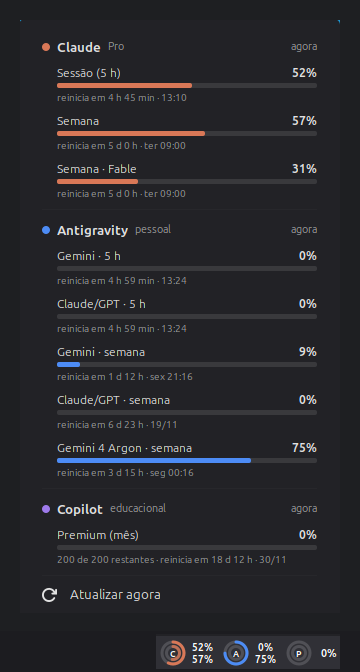

# CotaBar

Applet para a barra de tarefas do **Cinnamon** (Linux Mint) que mostra quanto da
cota de cada assistente de IA você já gastou — a janela **curta** (5 h / dia) e a
**longa** (semana / mês) — sem abrir nada.



Cada IA é um anel duplo com a letra dela no meio:

- **anel de fora** = janela longa (semana ou mês)
- **anel de dentro** = janela curta (5 h ou dia)
- ao lado, os dois números com a letra do período — **H** horas, **D** dia, **S** semana,
  **M** mês (ex.: `84% H` / `61% S`); ficam amarelos a partir de 80% e vermelhos a partir de 95%

Clicando, abre o detalhe de cada limite com barra, porcentagem e quando reinicia
("em 4 h 47 min · 13:10").

## O que ele lê

| IA | Letra | De onde vem | Janelas |
|---|---|---|---|
| **Claude Code** | C | `~/.claude/.credentials.json` → `api.anthropic.com/api/oauth/usage` (o mesmo do `/usage`) | sessão 5 h, semana, semana por modelo, uso extra do mês |
| **Antigravity** (`agy`) | A | `~/.gemini/antigravity-cli/antigravity-oauth-token` → `retrieveUserQuotaSummary` do Cloud Code | 5 h e semana por grupo de modelos (Gemini, Claude/GPT, Argon) |
| **Codex** (GPT) | X | `~/.codex/auth.json` → `chatgpt.com/backend-api/wham/usage` | 5 h e semana (ou créditos) |
| **GitHub Copilot** | P | `gh auth token` → `api.github.com/copilot_internal/user` | premium / chat do mês |

A IA que não está instalada fica escondida (dá para mostrar nas configurações).

### Regras que o coletor segue

- **Nunca renova token.** O refresh do Claude e do Codex troca o token e derrubaria
  a sessão aberta da ferramenta. Se o token venceu, o CotaBar avisa e mostra a última
  leitura boa — com token vencido a ferramenta está parada, então o uso não subiu;
  ele só zera as janelas que já reiniciaram.
- **Nunca grava token.** O JSON de saída só tem porcentagem, rótulo e horário.
- Um provedor com erro não derruba os outros; erro de rede mantém a leitura anterior por até 6 h.
- Só biblioteca padrão do Python 3. Sem pip, sem dependência.

## Como funciona

```
cotabar-coletor (Python)  ──►  ~/.cache/cotabar/usuario.json  ─┐
  roda pelo applet a cada N min                                ├─►  applet (GJS) desenha
cotabar-root.timer (systemd)  ──►  /var/lib/cotabar/root.json  ─┘
  opcional, para IAs logadas como root
```

O applet junta os arquivos das duas pastas; se a mesma IA aparece nos dois, vale a
leitura boa mais nova.

O timer do root existe para quem roda o Claude Code / agy com `sudo` (as credenciais
ficam em `/root`, que o usuário do painel não lê). Ele roda com `ProtectSystem=strict`,
`ProtectHome=read-only` e só escreve em `/var/lib/cotabar`.

## Instalar

```bash
git clone https://github.com/Davicjc/cotabar.git
cd cotabar
./instalar.sh            # applet + coletor para o seu usuário
sudo ./instalar.sh --root   # também o timer que lê as IAs logadas como root
# já está como root (sem sudo)? diga quem é o dono do painel: --usuario SEU_USUARIO
```

O applet entra no painel na hora (sem reiniciar o Cinnamon). Para tirar:
`./instalar.sh --remover` (ou `sudo ./instalar.sh --remover` se instalou com `--root`).

### Configurações

Botão direito no applet → **Configurar**. Tudo é chave ou lista, nada para digitar:

| Aba | Opção | Padrão |
|---|---|---|
| IAs | Claude Code / Antigravity / Codex / GitHub Copilot (uma chave cada) | ligadas |
| IAs | Esconder as que não estão instaladas | ligado |
| IAs | Ler as IAs logadas neste usuário | ligado |
| IAs | Consultar a cada | 5 min |
| Barra | Números ao lado do anel (curta e longa / só curta / só longa / só anéis) | curta e longa |
| Barra | Letra do período depois da % | ligado |

Se a mesma IA vem do usuário e do timer do root, o applet fica com a leitura boa mais recente.

### Rodar o coletor à mão

```bash
cotabar-coletor --imprimir                    # tudo, só mostra
cotabar-coletor --provedores claude,agy       # só alguns
```

## Testes

```bash
python3 -m unittest discover -s tests -v
```

## Créditos

A ideia veio do [Codenotch](https://github.com/vinzdg/codenotch) (macOS/Windows), que
mostra essas cotas num notch na borda da tela. O CotaBar é outra implementação, do
zero, para a barra do Cinnamon — nenhum código de lá foi copiado.

## Licença

MIT — veja [LICENSE](LICENSE).

---

Feito por [Davi Castro](https://davicjc.com).
