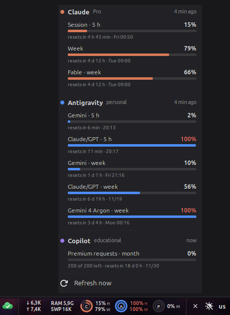

# CotaBar

[English](README.md) · **Português** · [Español](README.es.md)

**Saiba quanto já gastou das cotas das suas IAs de código — sem sair da área de trabalho.**
O CotaBar é um applet para a barra do Linux Mint / **Cinnamon** que mostra o uso do
**Claude Code**, **Codex (ChatGPT)**, **Antigravity (Gemini)** e **GitHub Copilot**:
a janela curta (5 horas / dia) e a longa (semana / mês), lado a lado.



[](https://github.com/Davicjc/cotabar/actions/workflows/testes.yml)


Chega de tomar "você atingiu o limite" no meio da tarefa. Uma olhada na barra e você sabe
se continua, troca de ferramenta ou espera o reinício.

## O que aparece

Cada IA é um anel duplo com a letra dela no meio:

- **anel de fora** — janela longa (semana ou mês)
- **anel de dentro** — janela curta (5 horas ou dia)
- ao lado, as duas porcentagens com a letra do período: **H** horas, **D** dia,
  **S** semana, **M** mês (ex.: `84% H` / `61% S`). Ficam amarelas a partir de 80% e vermelhas a partir de 95%.

Clicando, abre cada limite com barra, porcentagem e quando reinicia
("reinicia em 4 h 47 min · 13:10").

A interface fala **português, inglês e espanhol** (automático, ou escolha nas configurações).

## O que ele lê

| IA | Letra | De onde vem | Janelas |
|---|---|---|---|
| **Claude Code** | C | `~/.claude/.credentials.json` → `api.anthropic.com/api/oauth/usage` (o mesmo do `/usage`) | sessão 5 h, semana, semana por modelo, uso extra do mês |
| **Antigravity** (`agy`) | A | `~/.gemini/antigravity-cli/antigravity-oauth-token` → `retrieveUserQuotaSummary` do Cloud Code | 5 h e semana por grupo de modelos (Gemini, Claude/GPT, Argon) |
| **Codex** (ChatGPT) | X | `~/.codex/auth.json` → `chatgpt.com/backend-api/wham/usage` | 5 h e semana (ou créditos) |
| **GitHub Copilot** | P | `gh auth token` → `api.github.com/copilot_internal/user` | premium / chat do mês |

A IA que não está instalada fica escondida (dá para mostrar nas configurações).

> O suporte ao Codex segue o endpoint oficial de uso, mas ainda não foi testado com uma conta
> real — se você usa Codex, uma issue dizendo se funcionou ajuda muito.

## Seguro por padrão

- **Nunca renova token.** O refresh do Claude e do Codex troca o token e derrubaria a
  ferramenta aberta. Se o token venceu, o CotaBar avisa e mostra a última leitura boa — com
  token vencido a ferramenta está parada, então o uso não subiu; ele só zera as janelas que já reiniciaram.
- **Nunca grava token.** O JSON de saída só tem porcentagem, rótulo e horário.
- **Sem login novo, sem conta extra.** Usa a sessão que cada ferramenta já tem.
- Um provedor com erro não derruba os outros; erro de rede mantém a leitura anterior por até 6 h.
- Só biblioteca padrão do Python 3. Sem pip, sem dependência.

## Instalar

```bash
git clone https://github.com/Davicjc/cotabar.git
cd cotabar
./instalar.sh                # applet + coletor para o seu usuário
sudo ./instalar.sh --root    # também o timer para IAs logadas como root (ex.: `sudo claude`)
```

O applet entra na barra na hora, sem reiniciar o Cinnamon.
Desinstalar: `./instalar.sh --remove` (com `sudo` se usou `--root`).

Requisitos: Cinnamon (testado no 6.6 / Linux Mint 22) e Python 3.10+.

### Configurações

Botão direito no applet → **Configurar**. Tudo é chave ou lista:

| Aba | Opção | Padrão |
|---|---|---|
| IAs | Claude Code / Antigravity / Codex / GitHub Copilot (uma chave cada) | ligadas |
| IAs | Esconder as que não estão instaladas | ligado |
| IAs | Ler as IAs logadas neste usuário | ligado |
| IAs | Consultar a cada | 5 min |
| Barra | Números ao lado do anel (curta e longa / só curta / só longa / só anéis) | curta e longa |
| Barra | Letra do período depois da % | ligado |
| Barra | Idioma (automático / English / Español / Português) | automático |

## Como funciona

```
cotabar-coletor (Python)  ──►  ~/.cache/cotabar/usuario.json  ─┐
  roda pelo applet a cada N min                                ├─►  applet (GJS) desenha
cotabar-root.timer (systemd)  ──►  /var/lib/cotabar/root.json  ─┘
  opcional, para IAs logadas como root
```

O applet junta as duas pastas; se a mesma IA aparece nas duas, vale a leitura boa mais
recente. O timer do root roda com `ProtectSystem=strict` e `ProtectHome=read-only` e só
escreve em `/var/lib/cotabar`.

Rodar o coletor à mão:

```bash
cotabar-coletor --print                     # tudo, só mostra
cotabar-coletor --providers claude,agy      # só alguns
```

## Contribuir

Issues e pull requests são bem-vindos — principalmente **novos provedores** (Cursor, Gemini
CLI, Kimi, Grok…) e **traduções**. A janela de configurações é traduzida em
[`applet/cotabar@davicjc/po/`](applet/cotabar@davicjc/po/) (copie o `.pot`); os textos da
barra e do menu ficam na tabela `TEXTOS` no topo do `applet.js`.

```bash
python3 -m unittest discover -s tests -v
```

## Créditos

A ideia veio do [Codenotch](https://github.com/vinzdg/codenotch) (macOS/Windows), que mostra
essas cotas num notch na borda da tela. O CotaBar é outra implementação, do zero, para a
barra do Cinnamon — nenhum código de lá foi copiado.

## Licença

MIT — veja [LICENSE](LICENSE).

---

Feito por [Davi Castro](https://davicjc.com).
